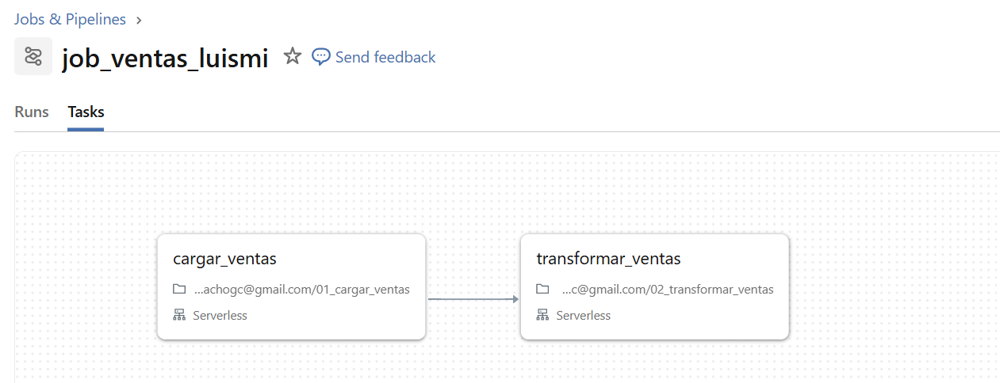
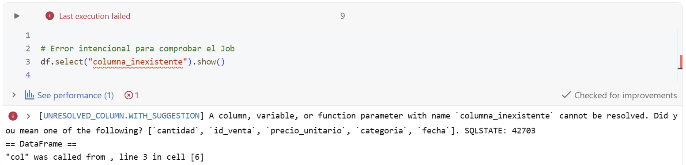
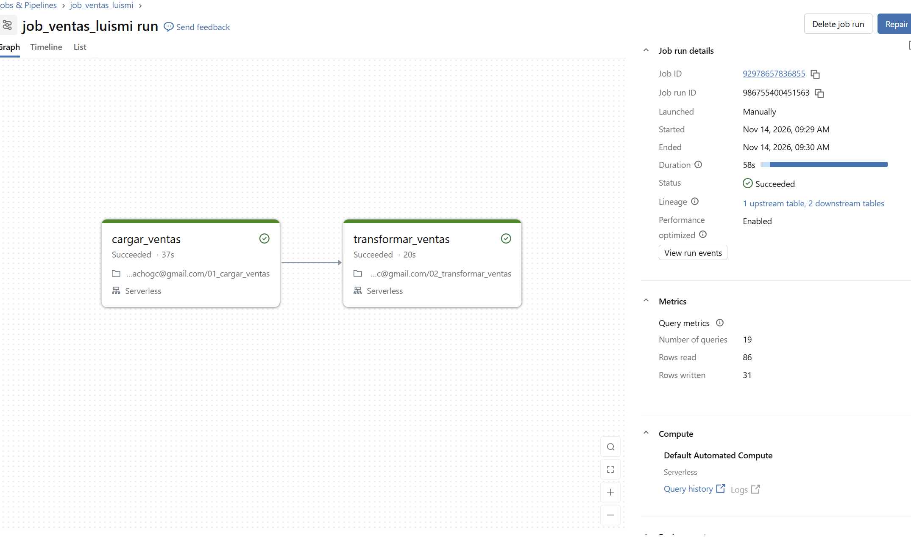
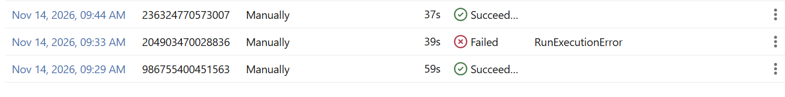

# Ejercicio 3. Automatización mediante un Job

## 3.1. Preguntas de investigación

### ¿Qué es un job en Databricks y para qué sirve?

Un job es una herramienta de Databricks que sirve para automatizar procesos relacionados con los datos. Por ejemplo, permite ejecutar notebooks y diferentes tareas siguiendo un orden establecido, sin tener que ejecutarlas manualmente.

### ¿Qué es una tarea y cómo se diferencia de un job?

Una tarea es una acción específica que se debe ejecutar, como correr un notebook para cargar o transformar información.

Ya en cuanto a un job, este permite agrupar varias tareas, organizarlas y controlar cómo se van a ejecutar.

### ¿Qué significa establecer dependencias entre tareas?

Significa indicar qué tareas deben terminar antes de que otras puedan comenzar.

Por ejemplo, en este ejercicio la tarea `transformar_ventas` depende de `cargar_ventas`, por lo que primero se deben cargar los datos correctamente para después realizar la transformación.

### ¿Qué información del historial de ejecuciones permite identificar un fallo?

El historial de ejecuciones nos permite revisar si las tareas terminaron correctamente, cuánto tiempo tardaron y qué errores se presentaron durante el proceso.

Con esta información podemos identificar cuál tarea falló y revisar los mensajes o registros para entender qué ocasionó el problema.

### Fuentes consultadas

- [Databricks Jobs](https://docs.databricks.com/aws/en/jobs/)
- [Configurar tareas en Jobs](https://docs.databricks.com/aws/en/jobs/tasks)
- [Supervisar ejecuciones](https://docs.databricks.com/aws/en/jobs/monitor)

## 3.2. Configuración y ejecución del Job

Para este ejercicio creé un job llamado `job_ventas_luismi`, en el cual configuré dos tareas:

1. `cargar_ventas`: se encarga de ejecutar el notebook `01_cargar_ventas`.
2. `transformar_ventas`: ejecuta el notebook `02_transformar_ventas`.

Las dos tareas utilizan cómputo Serverless de Databricks.

También configuré una dependencia para que primero se ejecute `cargar_ventas` y, cuando termine correctamente, pueda comenzar `transformar_ventas`.

## 3.3. Prueba de fallo controlado

Para comprobar cómo Databricks maneja los errores, agregué temporalmente una instrucción en el primer notebook:

```python
df.select("columna_inexistente").show()
```

Al ejecutar el job, se presentó un error porque estaba intentando consultar una columna que no existía dentro del DataFrame.

Databricks mostró el siguiente error:

`UNRESOLVED_COLUMN.WITH_SUGGESTION`

La ejecución falló después de 39 segundos.

Con esta prueba pude revisar cómo aparece un fallo en el historial de ejecuciones y cómo afecta a las tareas que dependen de la que presentó el error.

## 3.4. Corrección

Para solucionar el problema, eliminé la instrucción que intentaba consultar la columna inexistente y volví a ejecutar el job.

Con este ejercicio pude comprobar cómo funcionan las dependencias entre tareas en Databricks y cómo el historial de ejecuciones nos ayuda a encontrar errores y corregirlos.

## Evidencias

### Dependencias entre tareas



### Fallo controlado




### Ejecuciones exitosas y corrección




